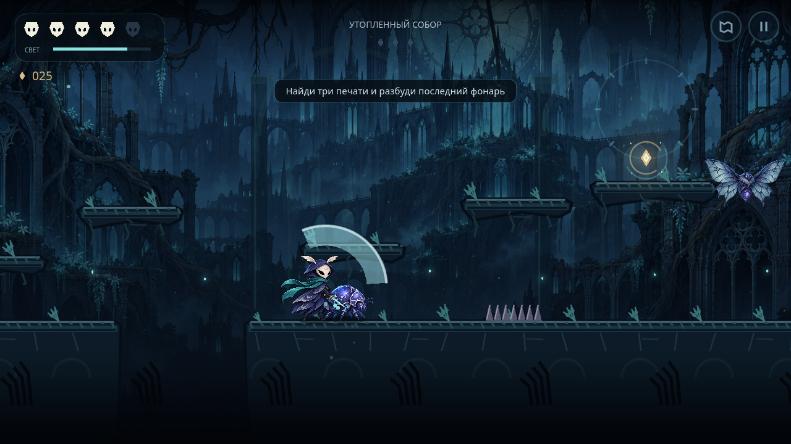

# VESPER - Песнь глубин

Оригинальное небольшое 2D-приключение: три подземные области, меч, двойной прыжок, рывок, лечение, печати и финальный босс. Полностью офлайн, без рекламы и покупок.

## Скачать и играть на Windows

Открой [Releases](https://github.com/shidikusik/VESPER/releases/latest) и скачай **VESPER-Windows-x64.zip**. Распакуй архив и запусти **VESPER.exe**. Или скачай EXE отдельно: все ресурсы встроены в него, установка не нужна.

Версия для 64-разрядной Windows. Для графики используется OpenGL Compatibility.

| Действие | Кнопки |
|---|---|
| Движение | A / D или стрелки |
| Прыжок и двойной прыжок | Пробел / W / вверх; повторное нажатие в воздухе |
| Меч | ЛКМ / J / Z, можно удерживать |
| Рывок | Shift / K / ПКМ |
| Лечение | Удерживать H / C, стоя на земле |
| Фонарь / сохранение | E рядом с фонарём |
| Карта | M / Tab |
| Пауза | Esc / P |
| Начать / продолжить / возродиться | Enter |
| Полный экран | F11 |

На ПК экранные кнопки телефона скрыты. Меню поддерживает мышь. Камера сохраняет пропорции мира на 4:3, 16:9 и широких экранах.

## Android

[Скачать VESPER-Android.apk](https://github.com/shidikusik/VESPER/releases/download/v1.0.1/VESPER-Android.apk) — около 84 МБ.

Проверенная Android-сборка 1.0.0: Android 7.0+, OpenGL ES 3.0, сенсорное управление и адаптация интерфейса к 4:3 и широким экранам. APK и его контрольная сумма добавлены в тот же релиз, что и Windows-версия.

## Цель

Найди три золотые печати на верхних платформах, открой врата Колыбели затмения, победи Стража и зажги последний фонарь. Фонари восстанавливают здоровье и свет. Прогресс сохраняется локально.

## Скриншоты



## Исходный проект

Godot 4.6.3 / GDScript. Открой `project.godot` в Godot и нажми F6/F5. Для Windows нужен export template этой же версии.

```sh
godot --headless --editor --import --quit
godot --headless --export-release "Windows Desktop" ../output/VESPER.exe
```

Проверки:

```sh
godot --headless --script res://tests/integration.gd -- --test
godot --headless --script res://tests/desktop.gd -- --test
```

Полные русские инструкции: [README-RU.md](README-RU.md).

## Объём версии

Это короткая игра с тремя областями и одной концовкой. Все способности доступны с начала. Персонажи используют рисованные спрайты с программной анимацией. Инвентаря, диалогов и системы экипировки нет.

Иллюстрации созданы специально для проекта с помощью ImageGen, музыка и эффекты синтезированы для игры. Сторонние уведомления и лицензии: [LICENSES.txt](LICENSES.txt).

Проект опубликован в аккаунте **shidikusik**.
